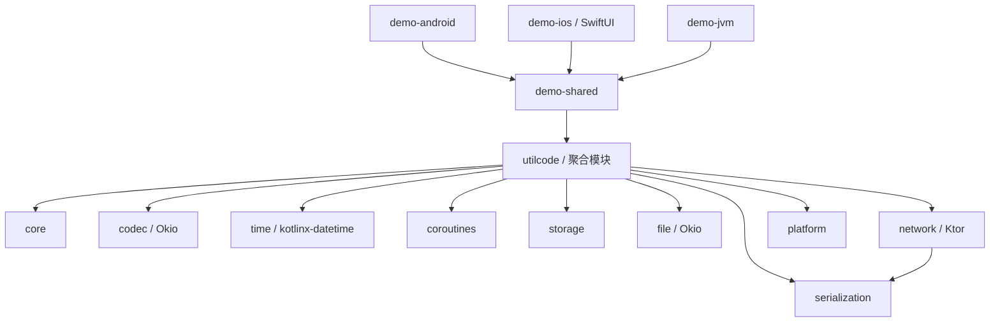

# 架构与平台矩阵

## 依赖方向

除了 `network → serialization`，各能力模块互相独立。`utilcode-core` 无第三方运行时依赖。聚合模块使用 `api(project(...))` 使所有依赖可见；追求产物精简时直接依赖所需模块。

## 平台矩阵

| 能力 | Android | iOS arm64 / simulator arm64 | JVM |
|---|---|---|---|
| 文本/集合/校验/数字/日志/LRU | commonMain | commonMain | commonMain |
| 编码/摘要 | Okio | Okio Native | Okio JVM |
| 日期/时区 | kotlinx-datetime | kotlinx-datetime | kotlinx-datetime |
| 协程/JSON | 公共实现 | 公共实现 | 公共实现 |
| 持久化 | SharedPreferences | NSUserDefaults 独立 suite | Preferences 独立 node |
| 文件 | Okio SYSTEM | Okio SYSTEM | Okio SYSTEM |
| HTTP | Ktor OkHttp | Ktor Darwin | Ktor OkHttp |
| 平台信息/UUID | Android Build / UUID | Foundation + UIKit | 系统属性 / UUID |
| dp/px、权限检查、剪贴板、分享等 | AndroidTools | 未提供统一 API | 未提供统一 API |

各平台持久化目录由系统隔离，命名相同不会自动同步。文件路径由宿主传入，不推断 Android/iOS 应用沙盒。UUID 是随机请求标识，不是永久设备 ID。

## 并发与生命周期

- 文本、校验、编码、时间工具和无状态 JSON 操作可以复用；自定义 Json 模块的线程安全责任属于调用者。
- `MemorySettings`、`LruCache` 不提供并发保护，限定单个线程/协程上下文，或使用业务层 Mutex。
- `persistentSettings` 使用系统偏好存储；单个读写可由系统处理，`read + increment + write` 不是事务，不适合并发计数。
- 文件与持久化 API 是阻塞调用，Android/JVM UI 层应放在 `Dispatchers.IO`。iOS 示例从后台队列调用共享层。
- `retry`、`parallelMap`、`tickerFlow`、`TaskGate` 都依附调用者的结构化并发，不持有全局 Scope，不吞取消。
- `NetworkClient` 拥有并关闭其 HttpClient（包括注入的 client）。在业务服务、ViewModel、Repository 的生命周期结束时关闭，避免每次请求都创建新实例。
- Android Demo 为 Activity 创建作用域，在 `onDestroy` 取消；示例弹窗关闭也取消本次任务。iOS Demo 通过完成回调回到主线程更新 UI，当前没有 Swift Task 到 Kotlin Job 的双向取消桥接；HTTP 有 15 秒超时。

## 文件边界

FileStore 创建并 canonicalize 调用者指定的根目录，拒绝绝对路径、`..`、反斜杠、冒号、NUL 和后续路径中的符号链接。它用于应用自己控制的目录。检查与实际 I/O 之间仍可能存在 TOCTOU，不能当作对抗本地恶意并发文件替换的 OS 安全沙盒。写入为覆盖写，不提供原子提交或文件锁；需要数据库级事务时采用专门存储库。

## 发布与兼容

初期版本使用 `0.1.0-SNAPSHOT`，API 可能调整。公共入口使用明确参数，不引入全局 Context/静态单例服务定位器。每个库模块有 Maven Publishing 配置，可发布到 Maven Local；远端生产发布和二进制兼容性检查列入路线图。

新增系统功能时：先判断语义是否真正跨平台一致；一致则定义能力接口和 actual；不一致则放在 `androidMain` / `iosMain` 专属扩展，并在文档矩阵中说明。
